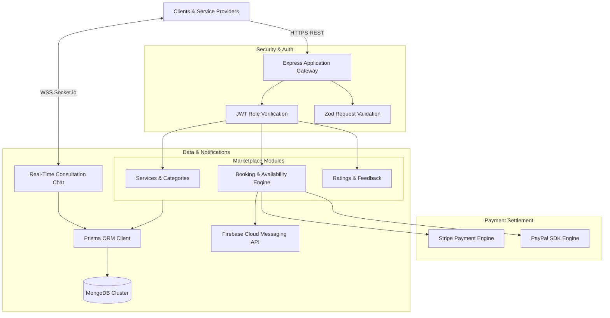

# Eze Ifenna Backend - On-Demand Services Marketplace API

<p align="center">
  
</p>

<p align="center">
  <a href="https://nodejs.org"></a>
  <a href="https://expressjs.com"></a>
  <a href="https://www.typescriptlang.org"></a>
  <a href="https://www.prisma.io"></a>
  <a href="https://www.mongodb.com"></a>
  <a href="https://socket.io"></a>
  <a href="https://stripe.com"></a>
  <a href="https://paypal.com"></a>
  <a href="LICENSE"></a>
</p>

---

## 📖 Overview

**eze_ifenna_backend** is an on-demand professional service booking marketplace API built with Node.js, Express.js, TypeScript, and Prisma ORM with MongoDB. The service manages provider availability matrices, booking reservations, dual Stripe and PayPal payments, real-time client-provider WebSocket chat, and Firebase Cloud Messaging alerts.

---

## ⚡ Key Features

- 🛠️ **Service Categories & Subcategories:** Dynamic taxonomy for booking diverse trades, beauticians, and home professionals.
- 📅 **Provider Availability Matrices:** Real-time provider shift management, preventing overlap and double-booking.
- 💳 **Dual Stripe & PayPal Checkout:** Full escrow and instant payment settlement supporting credit cards and PayPal wallets.
- 💬 **Real-Time Client-Provider Chat:** WebSocket communication via Socket.io for immediate location and timing coordination.
- 🔔 **Firebase Cloud Messaging:** Instant push alerts for booking confirmations, cancellations, and status changes.
- ☁️ **DigitalOcean Spaces CDN:** Identity verification and service portfolio file uploads.

---

## 🏗️ System Architecture



---

## 📂 Directory Structure

```text
.
├── src/
│   ├── app/
│   ├── components/
│   └── ...
├── assets/
│   └── banner.svg
├── .env.example
├── .gitignore
├── package.json
├── README.md
└── LICENSE
```

---

## 🛠️ Tech Stack & Dependencies

| Layer / Library | Version | Description |
|---|---|---|
| **Express.js** | `v4.21` | HTTP application framework |
| **TypeScript** | `v5.x` | Type safety across data contracts |
| **Prisma ORM** | `v6.x` | MongoDB modeling and query builder |
| **Socket.io** | `v4.8` | Real-time client-to-provider consultation |
| **Stripe SDK** | `v17.x` | Credit/debit card processing engine |
| **PayPal SDK** | `v2.x` | PayPal checkout integration |
| **Firebase Admin SDK** | `v13.x` | Push notification alert dispatch |

---

## ⚙️ Environment Variables

Create a `.env` file in the project root based on the provided sample:

```bash
cp .env.example .env
```

Configurable variables:

```env
PORT=5003
NODE_ENV=development
DATABASE_URL=mongodb+srv://<username>:<password>@cluster.mongodb.net/eze_ifenna?retryWrites=true&w=majority

JWT_SECRET=your_jwt_secret_key
EXPIRES_IN=30d

# Stripe
STRIPE_PK=pk_test_your_stripe_public_key
STRIPE_SK=sk_test_your_stripe_secret_key
STRIPE_WEBHOOK_SECRET=whsec_your_stripe_webhook_secret

# PayPal
PAYPAL_CLIENT_ID=your_paypal_client_id
PAYPAL_CLIENT_SECRET=your_paypal_client_secret
PAYPAL_MODE=sandbox

# DigitalOcean Spaces
DO_SPACES_ENDPOINT=https://nyc3.digitaloceanspaces.com
DO_SPACES_KEY=your_do_spaces_key
DO_SPACES_SECRET=your_do_spaces_secret
DO_SPACES_BUCKET=eze-ifenna-docs
```

---

## 🚀 Getting Started

### Prerequisites

- Node.js (v20.x or higher recommended)
- Package Manager (`npm`, `yarn`, or `pnpm`)

### Installation

```bash
# Clone repository
git clone https://github.com/shahjalal-labs/eze_ifenna_backend.git
cd eze_ifenna_backend

# Install dependencies
npm install
```

### Running Locally

```bash
# Start development server
npm run dev
# or for backend services
npm run start:dev
```

### Building for Production

```bash
# Create production build
npm run build

# Start production server
npm start
```

---

## 📄 License

This project is licensed under the [ISC License](LICENSE).
